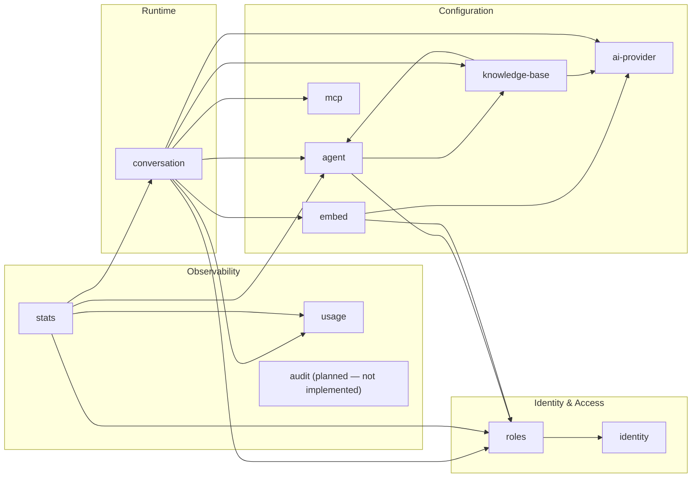

# Module Architecture

Talqo is a modular monolith: one API process (`apps/api`), one PostgreSQL database. Business capabilities live in modules under `apps/api/src/modules/<module>`, each owning its own tables and exposing behavior only through a service. Modules call each other's services directly (in-process), never each other's repositories or tables.

We want a **small, explicit** dependency graph: every arrow below is a real service call (a route handler calling another module's service counts), service-to-service dependencies stay acyclic, and most modules have at most one outgoing dependency (on `roles`).

## Module Dependency Graph

`identity` is a leaf: its service never calls another module (its routes delegate account deletion to `roles`). `audit` is planned, not implemented — no audit module or `AUDIT_LOG` table exists yet; when built, it will only ever receive calls (a write sink for activity log entries). `conversation` orchestrates sending messages. `stats` owns no tables: it composes the operator statistics read model from other modules' services. Separately, `knowledge-base` owns source-file lifecycle and serial ingestion, calling the configured embedding provider; its routes also call `agent.getAgent` to validate the agent exists, the graph's only module cycle (routes-to-service, so service-to-service calls stay acyclic).

Contract files may reference `roles` permission constants when declaring route `access.*`; those constant references are not service calls and are not drawn.

## Modules

| Module | Owns (tables) | Responsibility |
|---|---|---|
| `identity` | `USER`, `SESSION` | Who a person is: login credentials and active sessions. No knowledge of roles. |
| `roles` | `ROLE`, `ROLE_PERMISSION`, `ROLE_AGENT_PERMISSION`, `USER_ROLE`, `INVITATION`, `INVITATION_ROLE`, `PERMISSION_GRANT` | Roles and their assignments, the single admin grant, and the invite flow — owns "who can do what." |
| `agent` | `AGENT`, `BLACKLIST_WORD` | Deployment-owned agent branding, persona, and content policy. |
| `embed` | `EMBED` | Embeddable surfaces: appearance, public embed token, and the agent each one serves. One agent serves many embeds. |
| `ai-provider` | `AI_PROVIDER_CONFIG` | Deployment-wide model-provider credentials and model selection (a singleton, not per agent). |
| `mcp` | `MCP_SERVER` | Per-agent tool-server integrations over Streamable HTTP or stdio, with encrypted credentials and tool resolution during chat. One agent serves many connections. |
| `knowledge-base` | `agent_file`, `agent_file_chunk`; original uploads on disk | Agent source-file lifecycle, durable serial ingestion, Docling conversion/chunking, and per-agent pgvector storage, and chat retrieval. |
| `conversation` | `CONVERSATION`, `GENERATION_ATTEMPT`, `MESSAGE`, `CONVERSATION_DAILY_COUNTER` | Chat runtime; orchestrates a reply using agent config, knowledge retrieval, and the AI provider. Serves operators read-only transcripts by an operator-facing ID, never the visitor credential. |
| `usage` | `USAGE_RECORD` | Meters tokens per generation attempt; limit enforcement lives in `conversation`. |
| `stats` | No tables. Reads from `conversation`, `usage`, `agent` | Operator statistics at `GET /api/stats`. |
| `audit` (planned — not implemented) | `AUDIT_LOG` (planned) | Sink module: records actions performed by other modules. No outgoing dependencies. |

Every entity in [`docs/ERD.md`](../ERD.md) is owned by exactly one module, matching the "a module writes only its own tables" rule.
